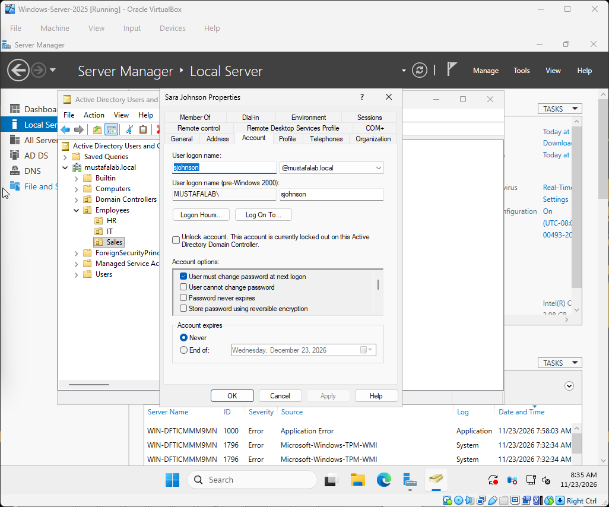
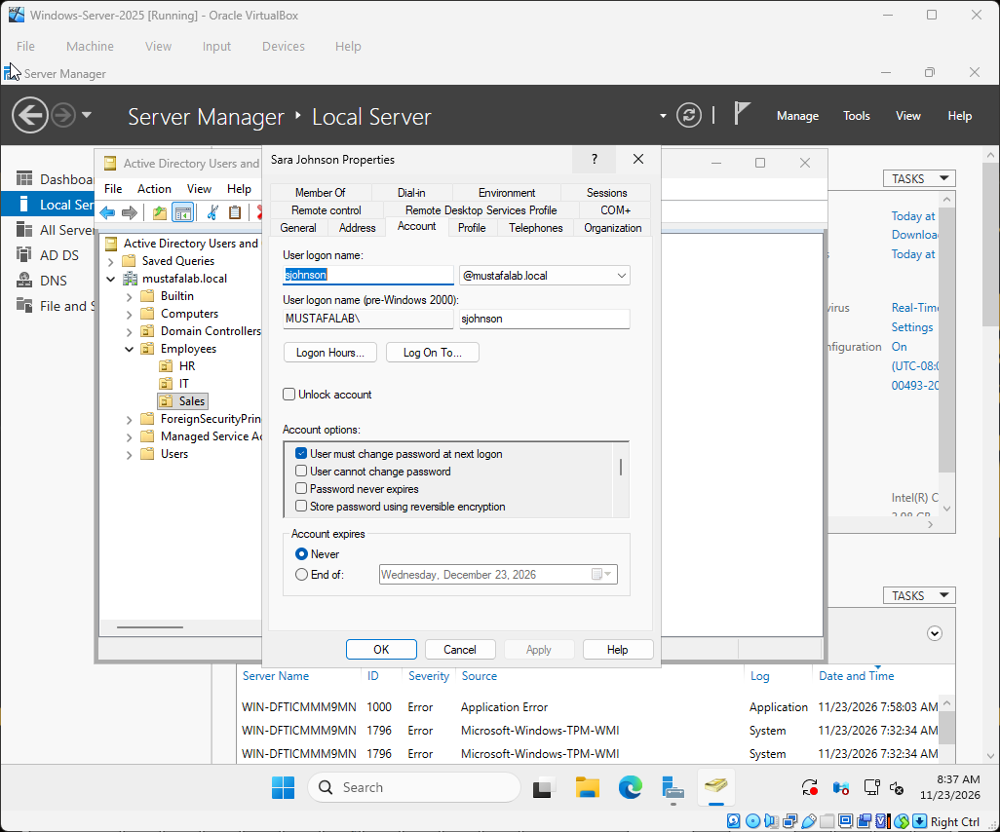

# HD-002 — Active Directory Account Lockout & Unlock

## Lab Overview
Simulated a Service Desk incident involving an employee account lockout in an Active Directory environment.

**Ticket:** HD-002  
**Environment:** Windows Server 2025 / Active Directory  
**Domain:** mustafalab.local  
**Employee:** Sarah Johnson (Sales Department)  
**Username:** sjohnson  
**Status:** Resolved

## Issue
Sarah Johnson, a simulated Sales employee, was unable to access her domain account because it was locked.

## Troubleshooting
1. Opened Active Directory Users and Computers (ADUC).
2. Navigated to the Sales organizational unit.
3. Located Sarah Johnson's account.
4. Opened the account properties.
5. Selected the Account tab.
6. Confirmed that Active Directory reported the account was locked out.

## Resolution
1. Selected the option to unlock the account.
2. Applied the change.
3. Reopened the account properties to verify the lockout message was no longer displayed.

## Verification
Confirmed that Active Directory no longer reported the account as locked.

**Note:** Successful end-user sign-in was not tested.

## Skills Demonstrated
- Active Directory user administration
- Account lockout troubleshooting
- Account unlocking
- Identity and access management
- Service Desk incident documentation

## Screenshot Evidence

### Account Locked

### Account Unlocked

