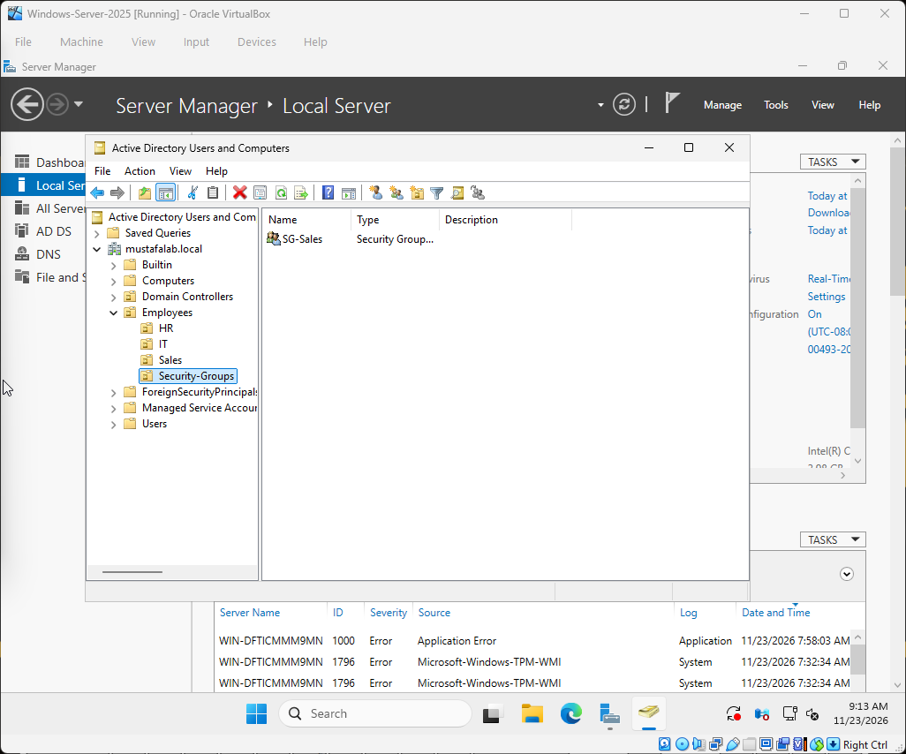
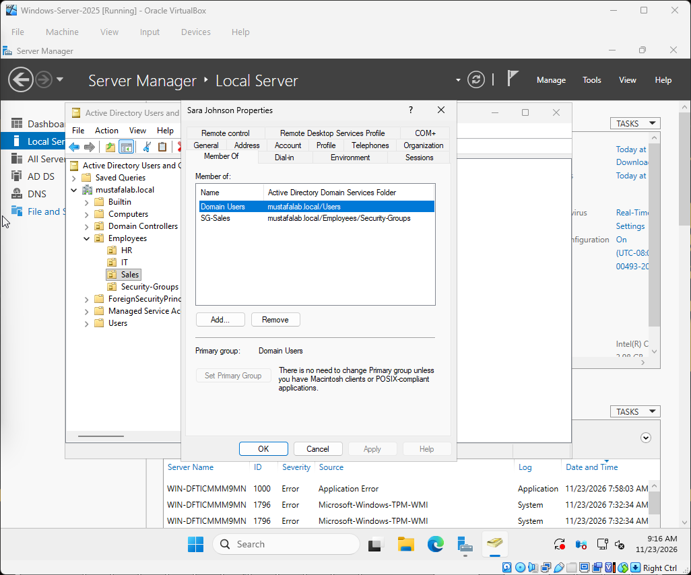
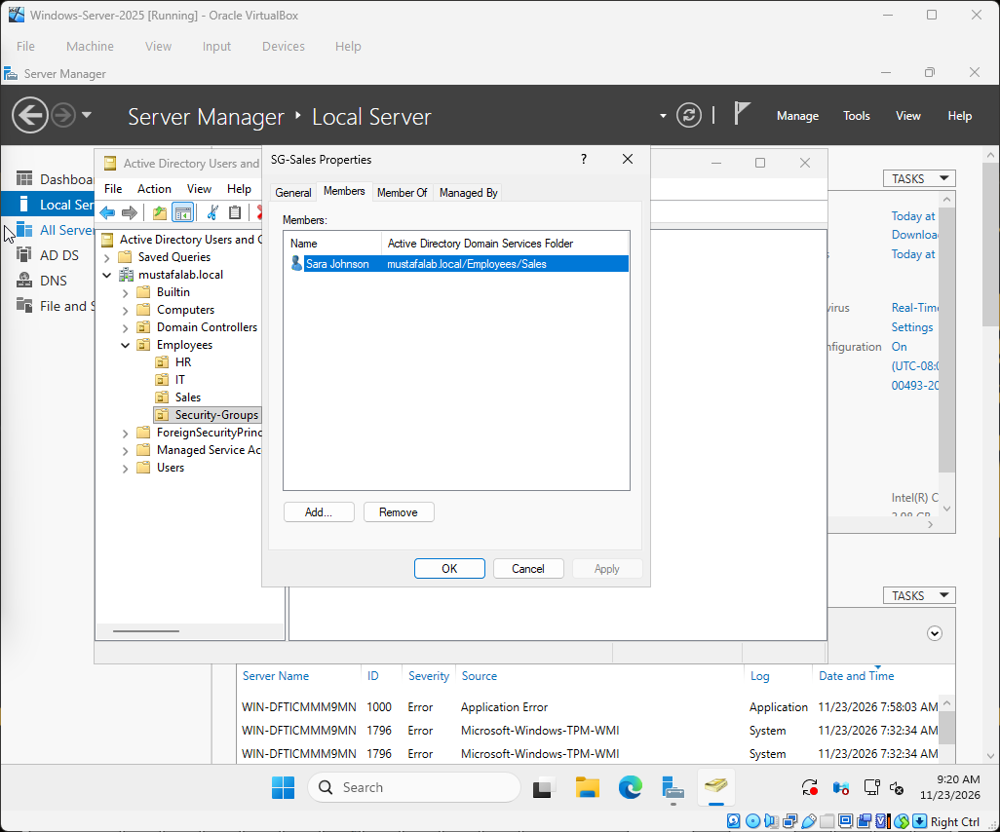

# HD-003 — Active Directory Security Group Management

## Lab Overview

**Ticket:** HD-003  
**Environment:** Windows Server 2025 / Active Directory  
**Domain:** mustafalab.local  
**Employee:** Sara Johnson (Sales Department)  
**Username:** sjohnson  
**Status:** Completed

## Issue

A simulated Sales employee, Sara Johnson, requires membership in the Sales security group as part of a departmental access request.

## Objective

Create an Active Directory security group, add the employee, and verify successful group membership.

## Troubleshooting and Resolution

1. Opened Active Directory Users and Computers (ADUC).
2. Created a new Organizational Unit named `Security-Groups` under `Employees`.
3. Created the `SG-Sales` security group.
4. Configured the group as **Global** with a **Security** group type.
5. Navigated to `Employees → Sales`.
6. Opened Sara Johnson's account properties.
7. Selected the **Member Of** tab.
8. Added Sara Johnson to `SG-Sales`.
9. Opened the security group's properties to confirm membership.

## Verification

Successfully verified membership through two methods:

- Sara Johnson's **Member Of** tab lists `SG-Sales`.
- The `SG-Sales` group's **Members** tab lists Sara Johnson.

**Note:** Resource permissions were not configured or tested in this lab.

## Skills Demonstrated

- Active Directory administration
- Security group creation
- User account management
- Group membership configuration
- Identity and access management
- Service Desk request documentation

## Screenshot Evidence

### 1. Security Group Created

### 2. User Group Membership

### 3. Group Membership Verified

