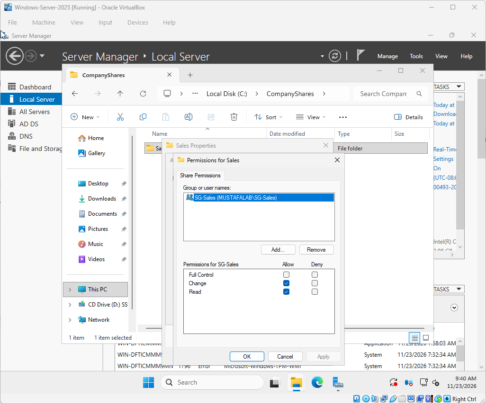
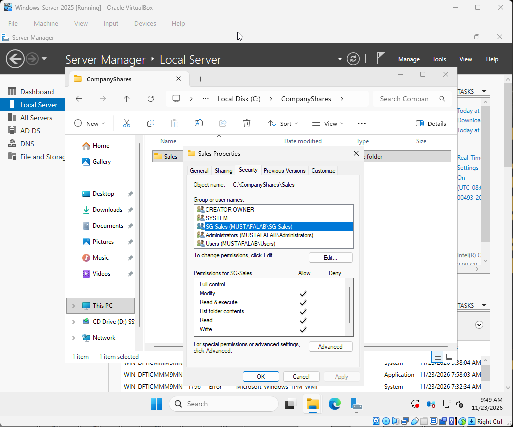
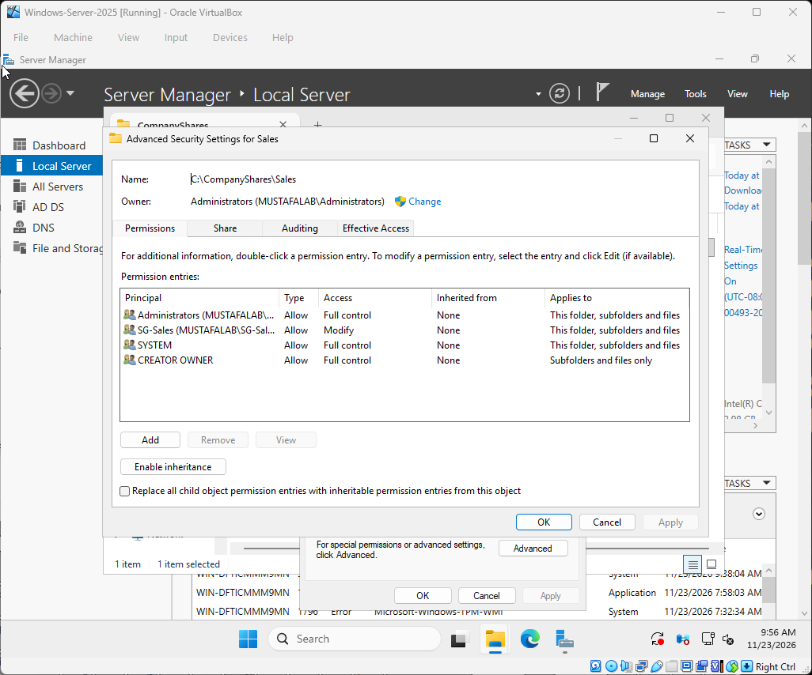

# HD-004 — Active Directory Shared Folder Permissions

## Lab Overview

**Ticket:** HD-004  
**Environment:** Windows Server 2025 / Active Directory  
**Domain:** mustafalab.local  
**Department:** Sales  
**Security Group:** SG-Sales  
**Status:** Permissions Configured and Verified

## Issue

A simulated Service Desk request requires configuring a shared departmental folder for Sales employees while restricting access for unauthorized users.

## Objective

Create a departmental shared folder, configure network share permissions and NTFS permissions, and verify the security settings.

## Troubleshooting and Resolution

1. Created the directory `C:\CompanyShares\Sales`.
2. Enabled Advanced Sharing for the Sales folder.
3. Configured the share name as `Sales`.
4. Removed `Everyone` from share permissions.
5. Added the Active Directory security group `SG-Sales`.
6. Assigned **Change** and **Read** share permissions to `SG-Sales`.
7. Opened the folder's Security settings.
8. Added `SG-Sales` to NTFS permissions.
9. Assigned **Modify** NTFS permissions.
10. Reviewed Advanced Security Settings.
11. Disabled permission inheritance and converted inherited permissions into explicit permissions.
12. Removed the unnecessary `MUSTAFALAB\Users` permission entries.
13. Retained Full Control for Administrators and SYSTEM.

## Verification

Confirmed the following:

- `SG-Sales` has Change and Read share permissions.
- `SG-Sales` has Modify NTFS permissions.
- General Users permissions were removed from the folder.
- Administrators and SYSTEM retain Full Control.
- Permission inheritance is disabled.

**Note:** End-user access testing will be completed after configuring the Windows 11 domain workstation.

## Skills Demonstrated

- Active Directory security group administration
- Windows Server folder sharing
- NTFS permissions
- Share permissions
- Access control
- Permission inheritance
- Least-privilege access configuration
- Service Desk documentation

## Screenshot Evidence

### 1. Share Permissions Configured

### 2. NTFS Permissions Configured

### 3. Final Advanced Security Settings

