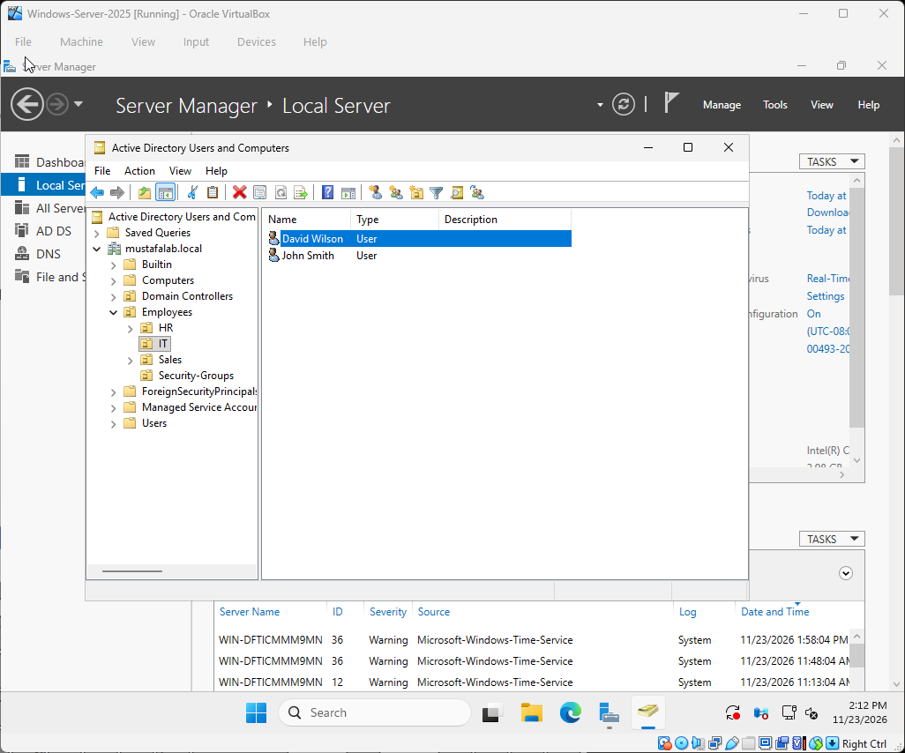
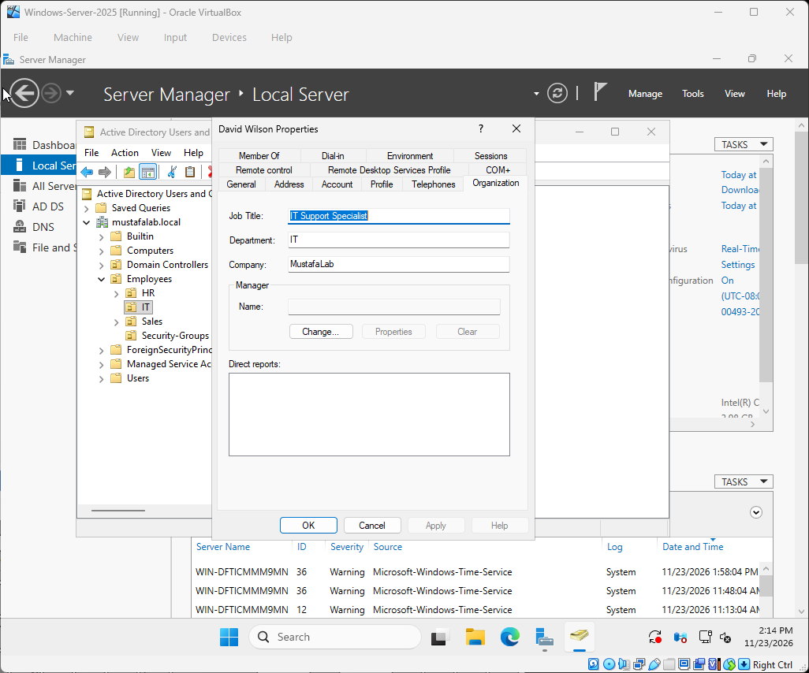
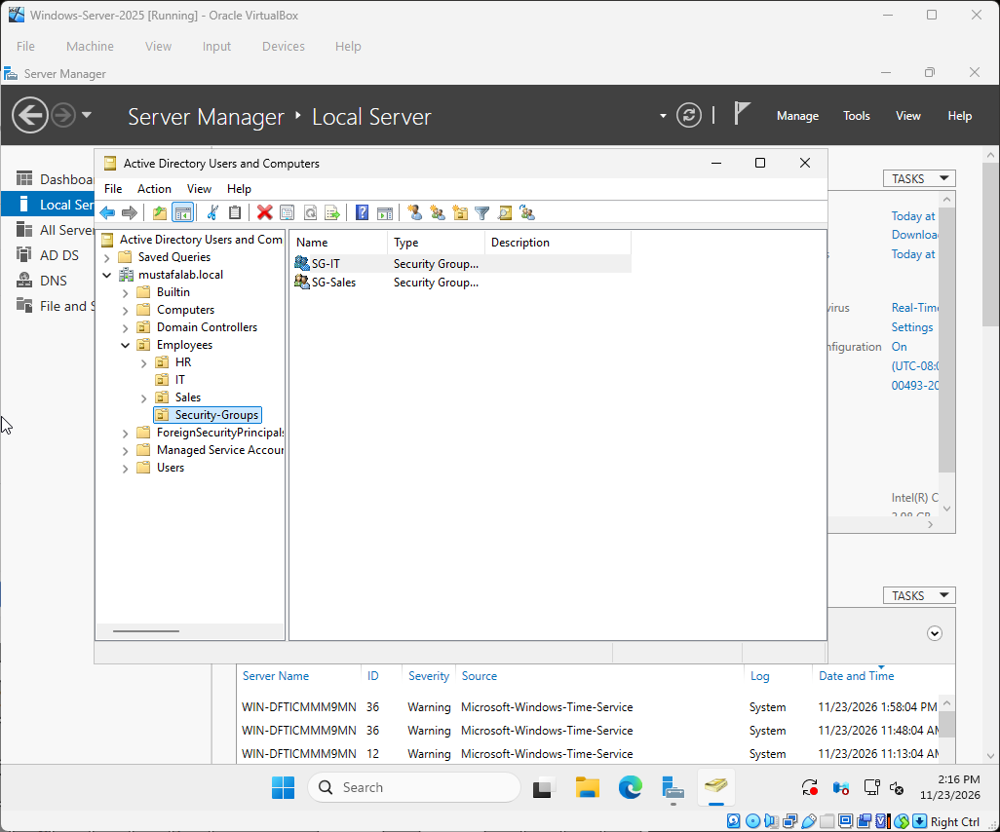
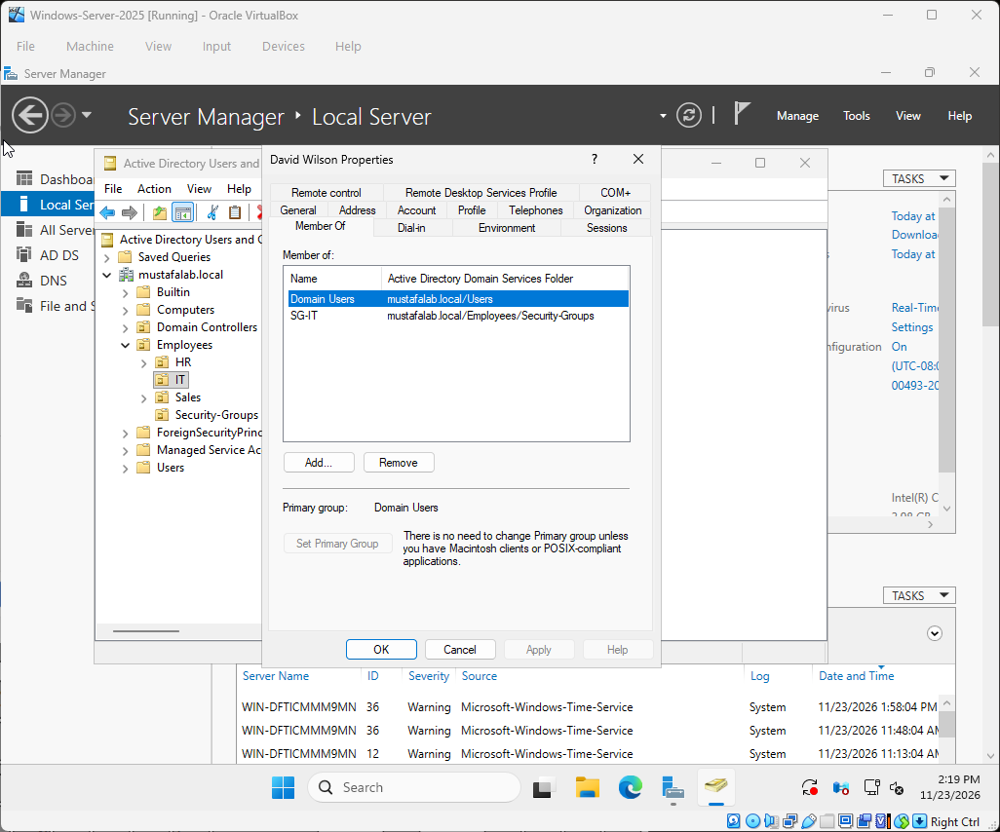
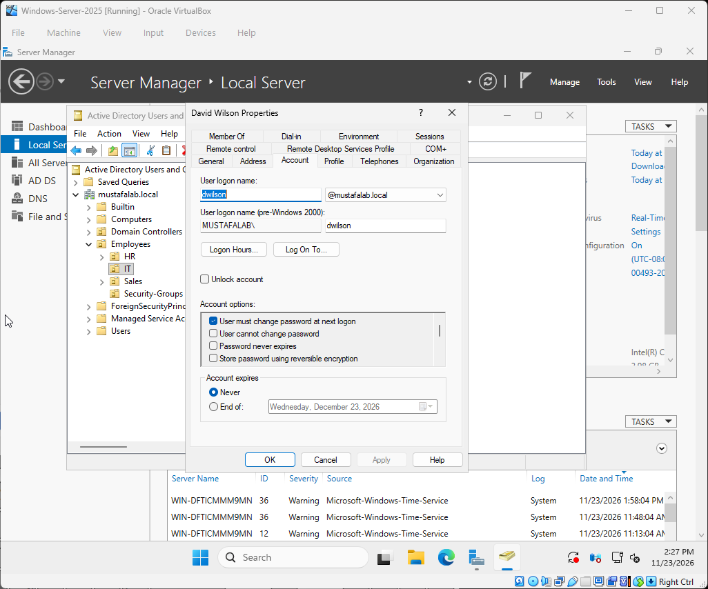

# HD-005 — Active Directory Employee Onboarding

## Lab Overview

**Ticket:** HD-005  
**Environment:** Windows Server 2025 / Active Directory  
**Domain:** mustafalab.local  
**Employee:** David Wilson (Simulated Employee)  
**Department:** IT  
**Position:** IT Support Specialist  
**Username:** dwilson  
**Status:** Account Provisioning Completed

## Issue

HR submitted a simulated onboarding request for a new IT Support Specialist, David Wilson. The employee requires an Active Directory account and appropriate departmental group membership.

## Objective

Provision a new employee account in Active Directory, configure employee information, assign departmental security group membership, and verify account settings.

## Troubleshooting and Resolution

1. Opened Active Directory Users and Computers (ADUC).
2. Navigated to `mustafalab.local → Employees → IT`.
3. Created a new user account for David Wilson.
4. Assigned the username `dwilson`.
5. Configured a temporary password.
6. Enabled **User must change password at next logon**.
7. Opened the user's Properties → Organization.
8. Configured the following employee information:
   - Job Title: IT Support Specialist
   - Department: IT
   - Company: MustafaLab
9. Navigated to `Employees → Security-Groups`.
10. Created a new Global Security Group named `SG-IT`.
11. Added David Wilson to `SG-IT`.
12. Verified the user's group membership.
13. Reviewed account settings to confirm the correct username, domain, and password requirements.

## Verification

Confirmed that:

- David Wilson's account exists in the IT organizational unit.
- Employee information is correctly configured.
- The `SG-IT` security group exists.
- David Wilson is a member of `SG-IT`.
- The account is configured to require a password change at the next logon.

**Note:** Successful workstation sign-in and access testing have not yet been performed.

## Skills Demonstrated

- Active Directory user provisioning
- Employee onboarding
- Organizational Unit management
- User account configuration
- Security group creation
- Group membership management
- Identity and access management
- Service Desk request fulfillment
- Technical documentation

## Screenshot Evidence

### 1. Employee Account Created

### 2. Employee Information Configured

### 3. IT Security Group Created

### 4. Security Group Membership Assigned

### 5. Account Settings Verified

