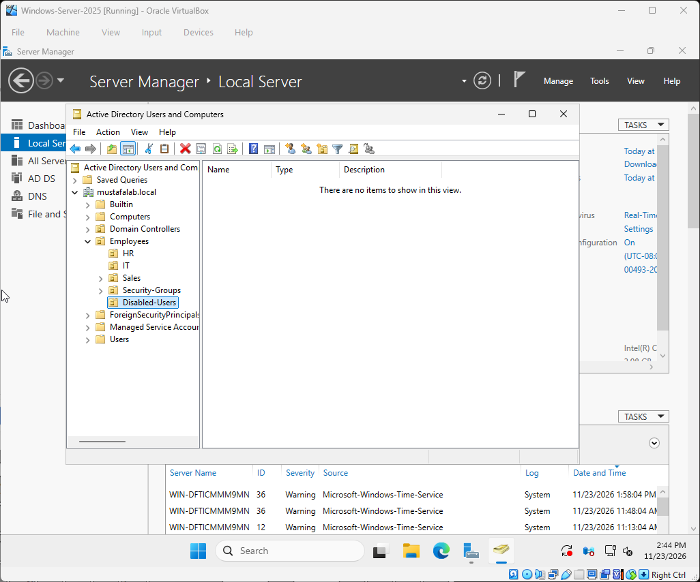
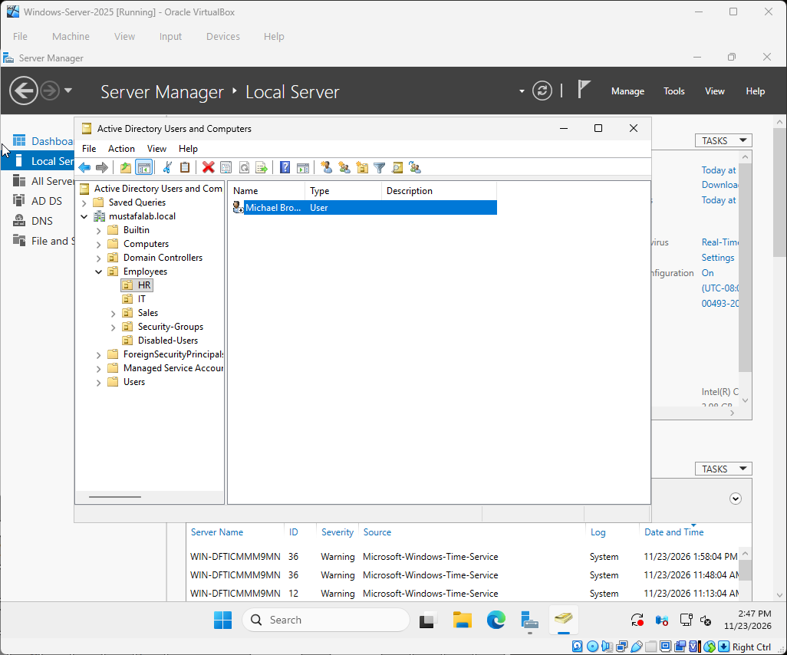
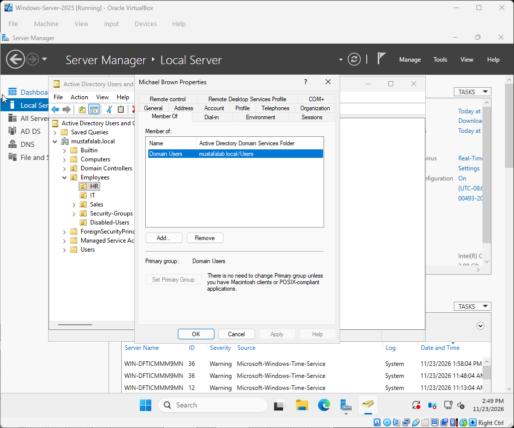
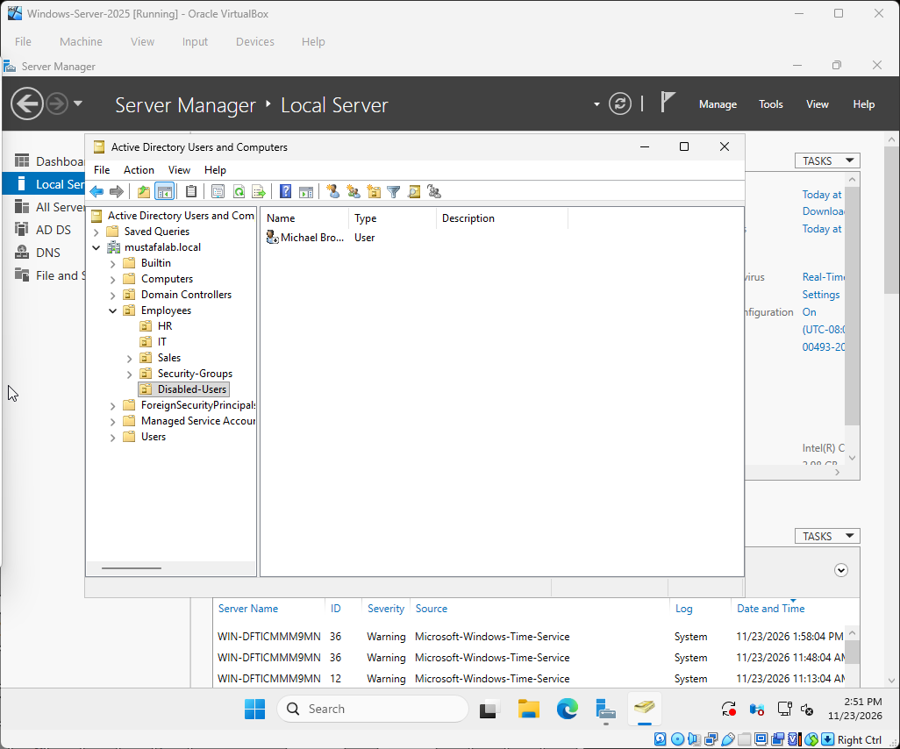
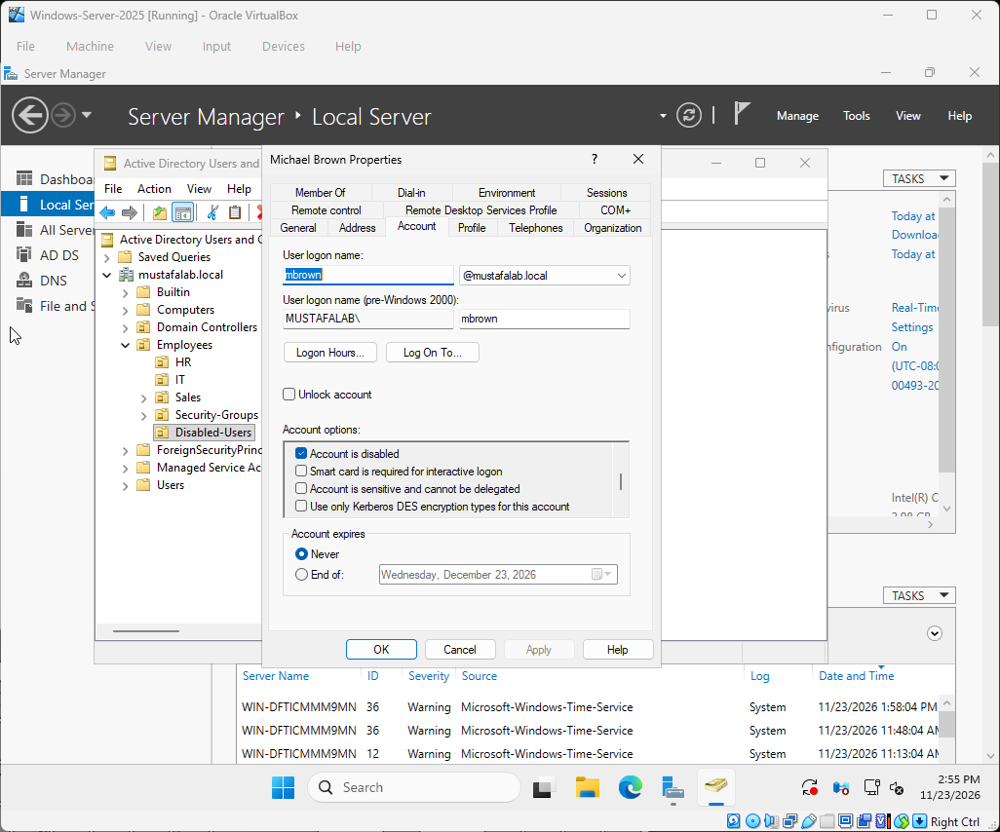

# HD-006 — Active Directory Employee Offboarding

## Lab Overview

**Ticket:** HD-006  
**Environment:** Windows Server 2025 / Active Directory  
**Domain:** mustafalab.local  
**Employee:** Michael Brown (Simulated Employee)  
**Department:** Human Resources (HR)  
**Username:** mbrown  
**Status:** Account Deactivated — Configuration Verified

## Issue

HR submitted a simulated Service Desk request to deactivate Michael Brown's Active Directory account following his departure from MustafaLab.

## Objective

Disable the employee's account, review security group memberships, move the account into a designated Disabled-Users organizational unit, and verify its status.

## Troubleshooting and Resolution

1. Opened Active Directory Users and Computers (ADUC).
2. Created a new organizational unit named `Disabled-Users` under `Employees`.
3. Navigated to the HR organizational unit.
4. Located Michael Brown's account.
5. Disabled the account using the **Disable Account** option.
6. Reviewed the account's **Member Of** tab.
7. Confirmed the account belonged only to the default `Domain Users` group.
8. Determined that no additional departmental group memberships required removal.
9. Moved the disabled account into the `Disabled-Users` OU.
10. Opened the account properties and verified **Account is disabled** was selected.

## Verification

Confirmed the following:

- The `Disabled-Users` organizational unit exists.
- Michael Brown's account is located inside `Disabled-Users`.
- The account is disabled in Active Directory.
- The account has no additional departmental security group memberships.
- The account remains retained for administrative records.

**Note:** Workstation sign-in denial was not tested. Account disablement was verified through Active Directory account settings.

## Skills Demonstrated

- Active Directory administration
- Employee offboarding
- Account deactivation
- Security group membership review
- Organizational Unit management
- Identity and access management
- Access revocation procedures
- Service Desk request documentation

## Screenshot Evidence

### 1. Disabled-Users Organizational Unit Created

### 2. Employee Account Disabled

### 3. Security Group Membership Reviewed

### 4. Account Moved to Disabled-Users

### 5. Disabled Account Status Verified

