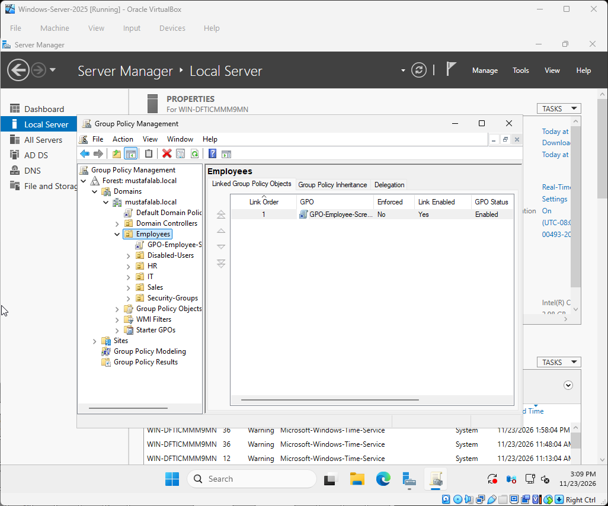
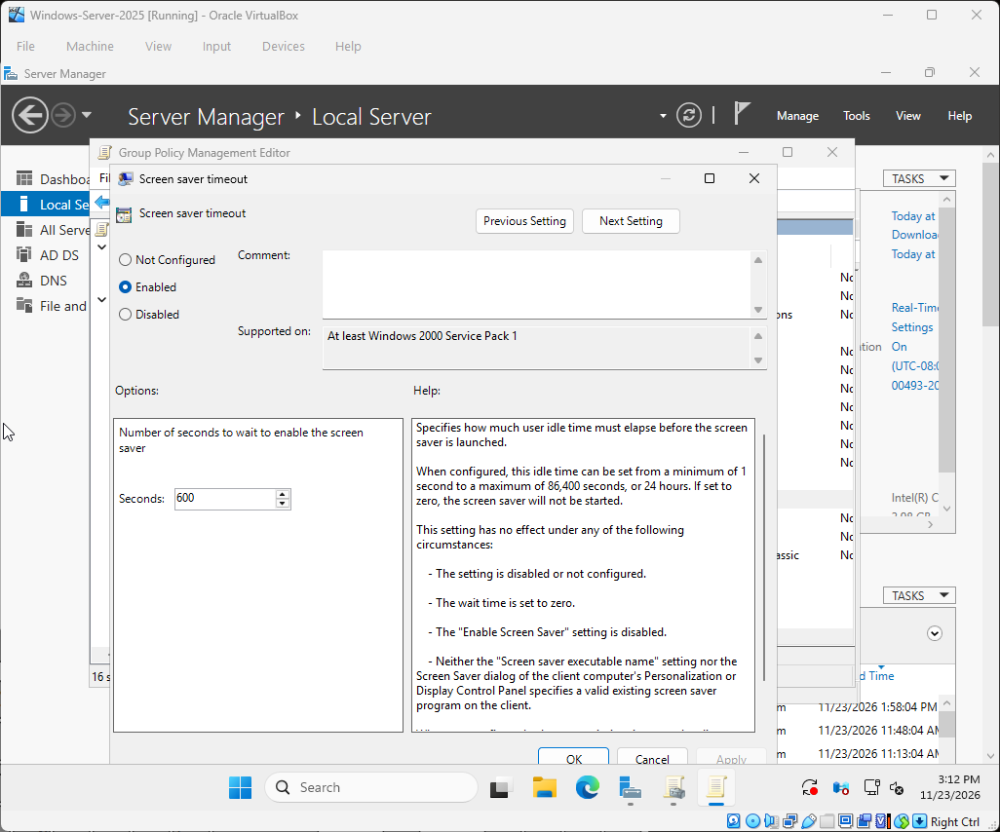
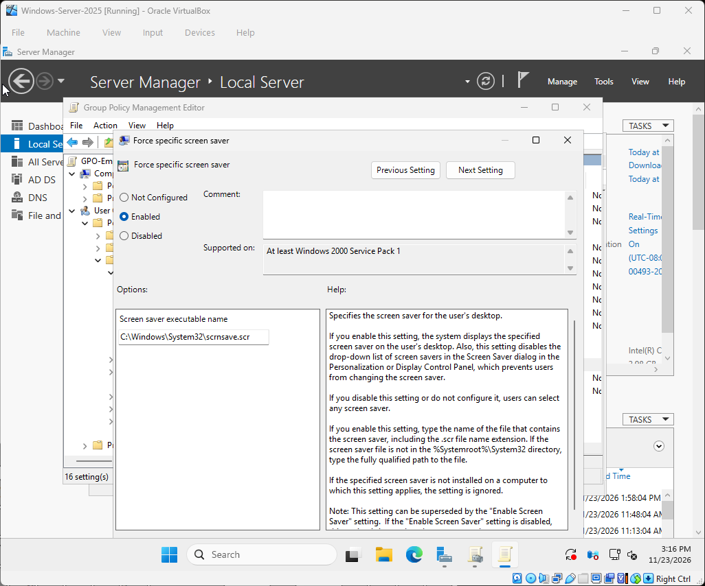
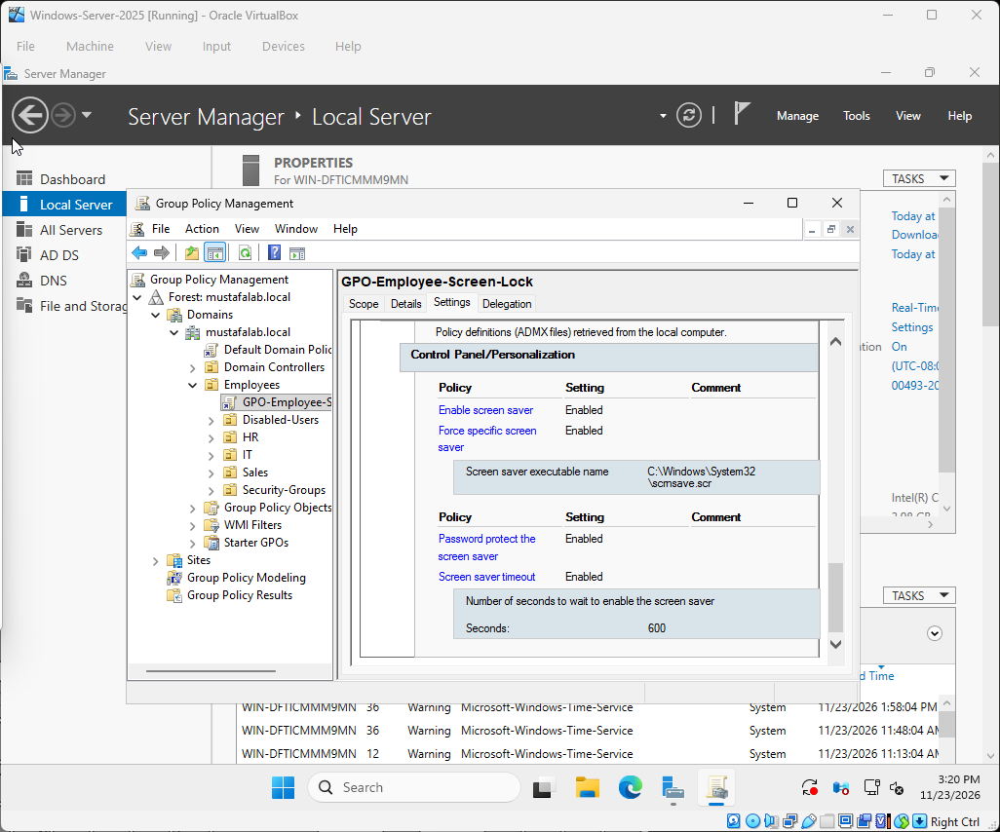

# HD-007 — Active Directory Group Policy Management

## Lab Overview

**Ticket:** HD-007  
**Environment:** Windows Server 2025 / Active Directory  
**Domain:** mustafalab.local  
**Organizational Unit:** Employees  
**Group Policy Object:** GPO-Employee-Screen-Lock  
**Status:** GPO Configured — Client Verification Pending

## Issue

MustafaLab's IT department submitted a simulated request to implement an automatic screen-lock policy for employee workstations after 10 minutes of inactivity.

## Objective

Create a Group Policy Object (GPO), link it to the Employees organizational unit, configure screen saver security settings, and verify the configuration.

## Configuration Steps

1. Opened Server Manager → Tools → Group Policy Management.
2. Navigated to `Forest → Domains → mustafalab.local → Employees`.
3. Created a new GPO named `GPO-Employee-Screen-Lock`.
4. Linked the GPO to the Employees organizational unit.
5. Opened Group Policy Management Editor.
6. Navigated to:

   `User Configuration → Policies → Administrative Templates → Control Panel → Personalization`

7. Enabled **Enable screen saver**.
8. Enabled **Password protect the screen saver**.
9. Enabled **Screen saver timeout** and configured the timeout to `600 seconds`.
10. Enabled **Force specific screen saver**.
11. Configured the screen saver executable as:

    `C:\Windows\System32\scrnsave.scr`

12. Saved the policy settings.

## Verification

Confirmed through Group Policy Management that:

- The GPO is linked to the Employees OU.
- The GPO link is enabled.
- Screen saver functionality is enabled.
- Password protection is enabled.
- Screen saver timeout is configured to 600 seconds.
- A specific screen saver executable is configured.

**Note:** Client-side policy application and automatic workstation locking have not yet been tested.

## Skills Demonstrated

- Active Directory Group Policy Management
- Group Policy Object creation
- Organizational Unit policy linking
- Windows security configuration
- User Configuration policies
- Endpoint security fundamentals
- IT support documentation

## Screenshot Evidence

### 1. GPO Created and Linked

### 2. Screen Saver Timeout Configured

### 3. Screen Saver Configured

### 4. Group Policy Settings Verified

