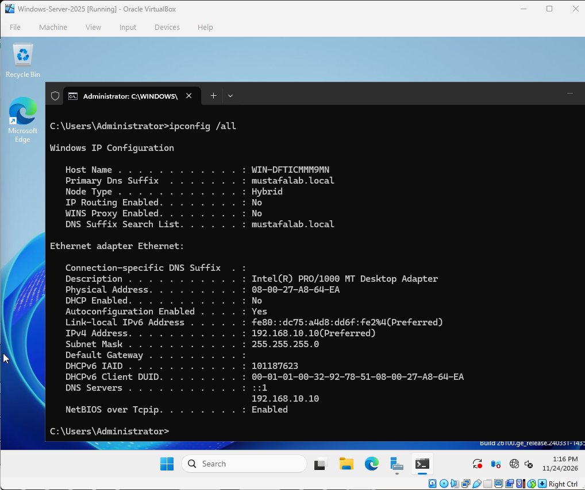
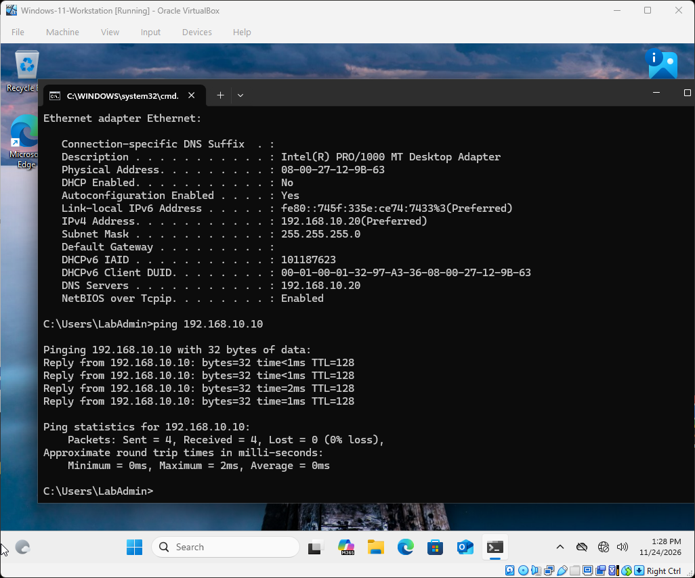
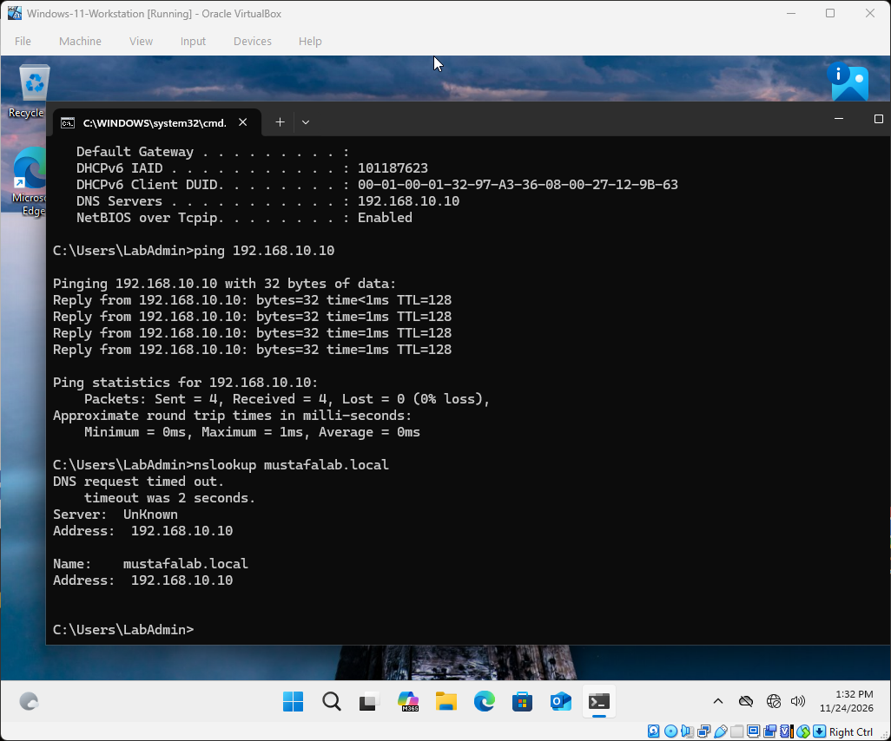
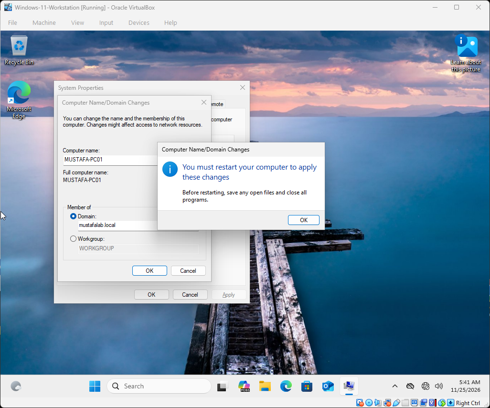
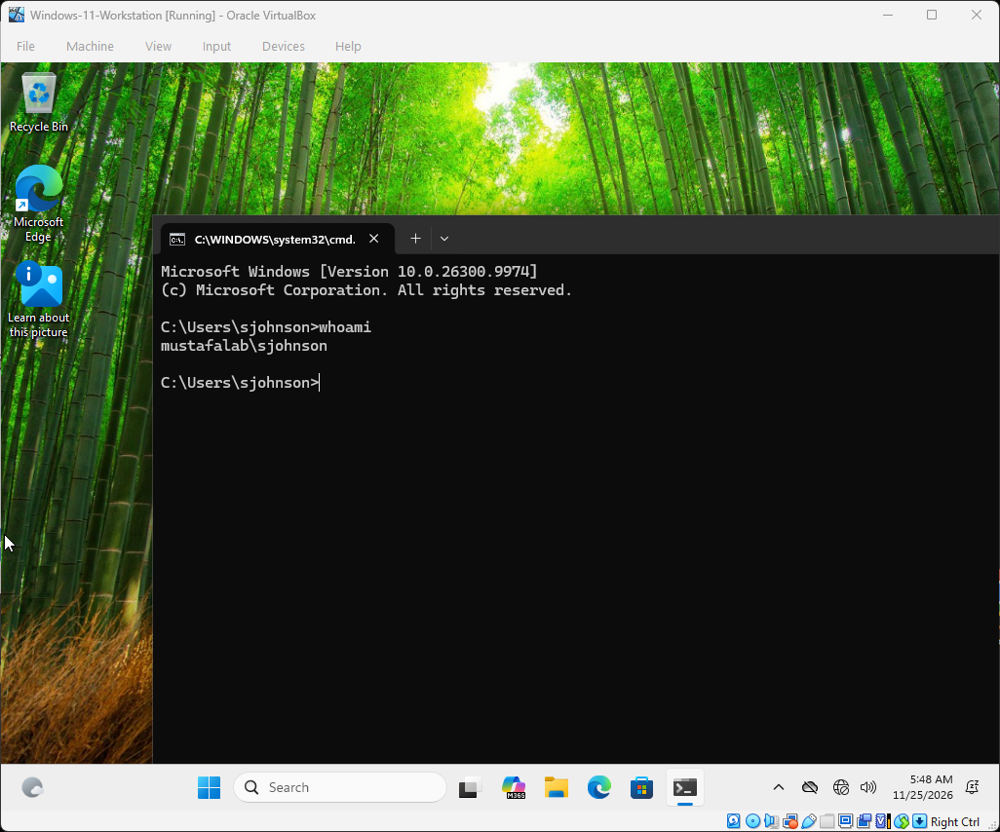
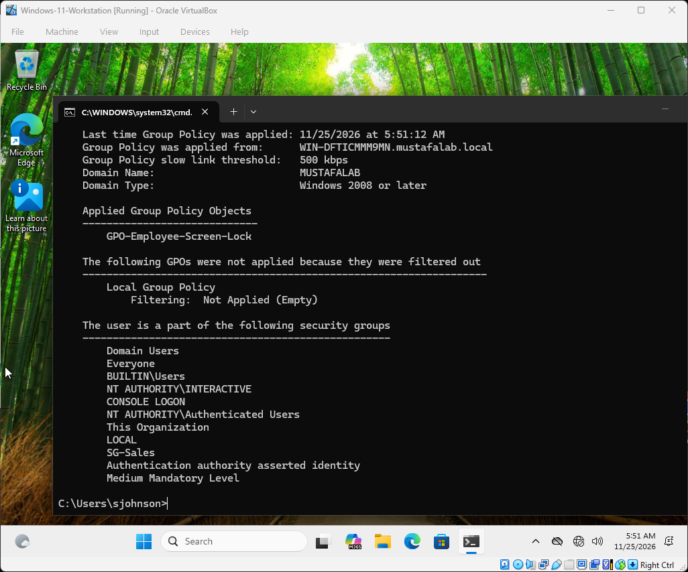
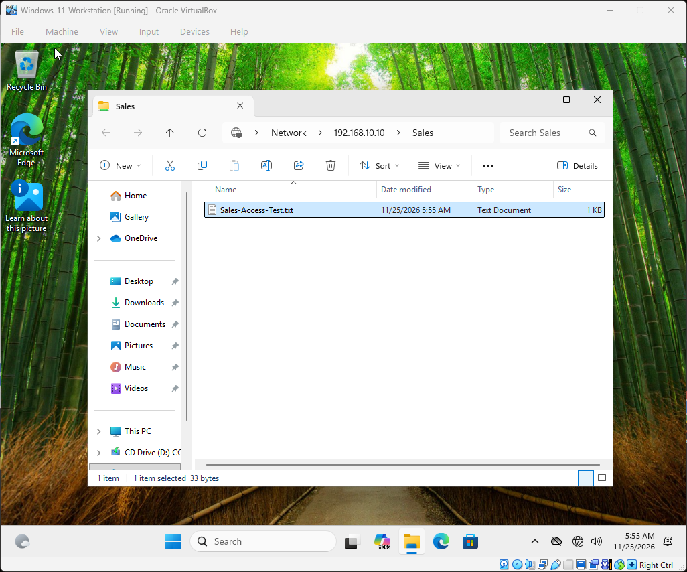

# HD-008 — Windows 11 Domain Join & Access Verification

## Lab Overview

**Ticket:** HD-008  
**Environment:** Windows Server 2025 / Windows 11 Pro / VirtualBox  
**Domain:** mustafalab.local  
**Workstation:** MUSTAFA-PC01  
**Employee:** Sara Johnson (Sales)  
**Username:** sjohnson  
**Status:** Completed

## Scenario

A simulated Service Desk request requires configuring a new Windows 11 workstation, joining it to the company domain, and verifying employee access to network resources.

## Objective

Connect a Windows 11 workstation to Active Directory, configure networking, authenticate a domain user, verify Group Policy application, and test access to a departmental shared folder.

## Configuration and Troubleshooting

1. Created a Windows 11 Pro virtual machine using Oracle VirtualBox.
2. Configured both virtual machines on the `MustafaLab` internal network.
3. Assigned the following static IP addresses:
   - Windows Server 2025: `192.168.10.10`
   - Windows 11 Pro: `192.168.10.20`
4. Configured Windows 11 to use `192.168.10.10` as its DNS server.
5. Used `ipconfig /all` to verify network configuration.
6. Used `ping` to confirm connectivity between the workstation and server.
7. Used `nslookup` to verify domain name resolution.
8. Resolved an IP address conflict and corrected an incorrect DNS server configuration.
9. Joined workstation `MUSTAFA-PC01` to `mustafalab.local`.
10. Restarted Windows 11.
11. Successfully authenticated using the domain account `MUSTAFALAB\sjohnson`.
12. Used `whoami` to verify the authenticated domain identity.
13. Ran `gpupdate /force` and `gpresult /r`.
14. Confirmed `GPO-Employee-Screen-Lock` appeared under applied Group Policy Objects.
15. Accessed the Sales shared folder at `\\192.168.10.10\Sales`.
16. Created and saved `Sales-Access-Test.txt` to verify write access.

## Verification

Successfully confirmed:

- Network connectivity between both virtual machines.
- DNS resolution for `mustafalab.local`.
- Windows 11 domain membership.
- Successful domain user authentication.
- Application of `GPO-Employee-Screen-Lock`.
- Membership in the `SG-Sales` security group.
- Access to the Sales shared folder.
- Ability to create and save files in the shared folder.

**Note:** The screen-lock GPO was confirmed as applied, but the actual 10-minute automatic screen-lock behavior was not tested.

## Skills Demonstrated

- Windows 11 workstation deployment
- Active Directory domain joining
- TCP/IP network configuration
- DNS troubleshooting
- IP address conflict resolution
- Domain authentication
- Group Policy troubleshooting
- Windows Command Prompt
- Network share access
- NTFS and share permission validation
- Technical documentation

## Screenshot Evidence

### 1. Windows Server IP Configuration

### 2. Windows 11 IP Configuration

### 3. Network Connectivity and DNS Verification

### 4. Windows 11 Domain Join

### 5. Domain User Login

### 6. Group Policy Applied

### 7. Sales Shared Folder Access

