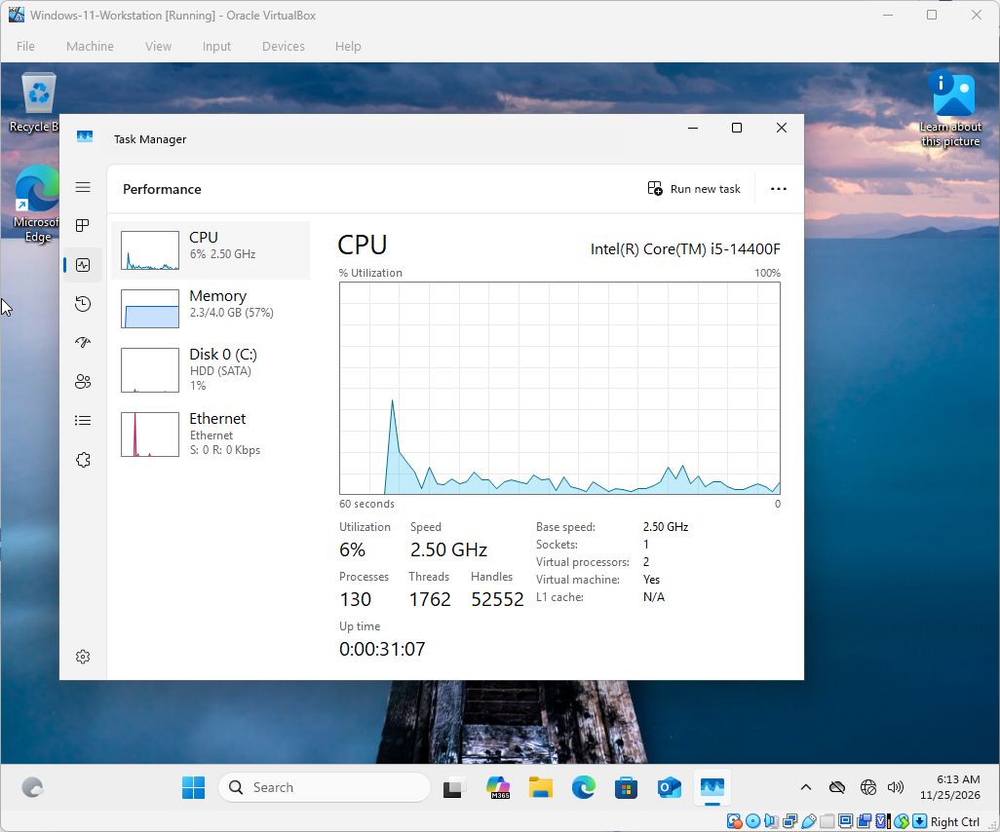
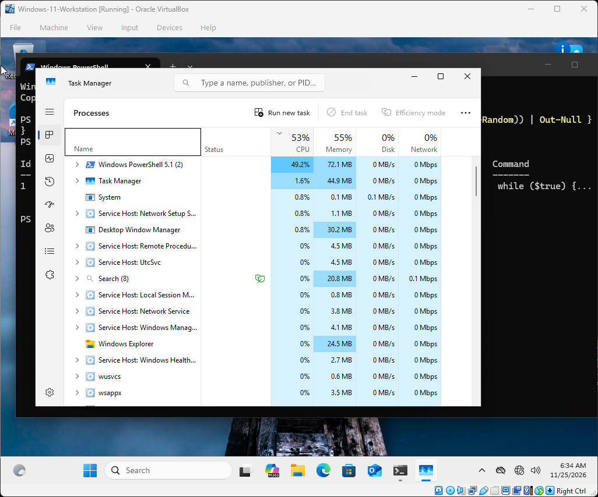
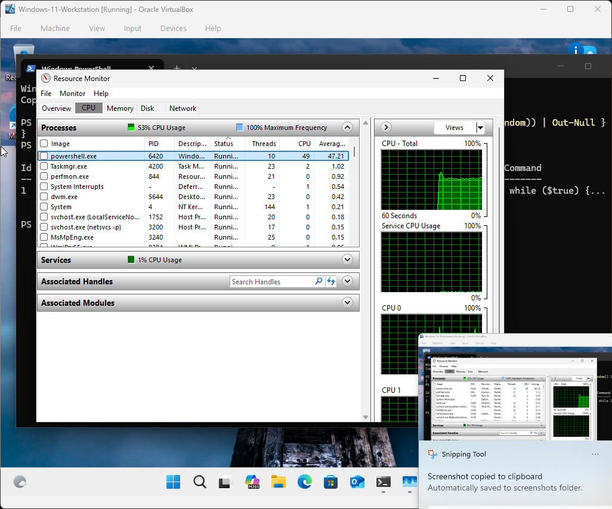
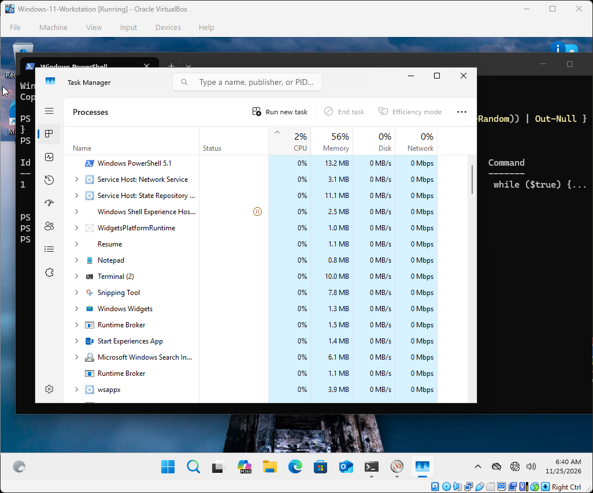

# WIN-001 — Windows 11 High CPU Troubleshooting

## Lab Overview

**Ticket:** WIN-001  
**Environment:** Windows 11 Pro / Oracle VirtualBox  
**Tools:** Task Manager, Resource Monitor, Windows PowerShell  
**Status:** Resolved

## Issue

A simulated employee reported that their Windows 11 workstation was experiencing slow performance.

The objective was to investigate excessive CPU utilization, identify the responsible process, and restore normal system performance.

## Troubleshooting and Resolution

1. Opened Windows Task Manager to review system performance.
2. Recorded baseline CPU utilization.
3. Used Windows PowerShell to simulate a CPU-intensive background process.
4. Executed `Get-Job` to verify the background job was running.
5. Opened Task Manager and sorted processes by CPU utilization.
6. Identified Windows PowerShell as the primary CPU-consuming process.
7. Observed approximately 53% total CPU utilization, with PowerShell consuming approximately 49%.
8. Opened Resource Monitor using `resmon`.
9. Investigated the `powershell.exe` process and confirmed its CPU consumption.
10. Returned to PowerShell and stopped the simulated background job.
11. Removed the completed job.
12. Reopened Task Manager to verify CPU utilization decreased.

## PowerShell Commands Used

### Start Simulated CPU Workload

```powershell
$job = Start-Job -ScriptBlock { while ($true) { [Math]::Sqrt((Get-Random)) | Out-Null } }
```

### Verify Background Job

```powershell
Get-Job
```

### Stop Background Job

```powershell
Stop-Job -Job $job
```

### Remove Background Job

```powershell
Remove-Job -Job $job
```

## Root Cause

A deliberately created PowerShell background job was continuously executing mathematical calculations, resulting in elevated CPU utilization.

## Resolution

Stopped and removed the CPU-intensive PowerShell background job.

## Verification

**Before Resolution:**
- Total CPU utilization: Approximately 53%
- PowerShell CPU utilization: Approximately 49%

**After Resolution:**
- Total CPU utilization: Approximately 2%
- PowerShell no longer consuming excessive CPU resources

The simulated performance issue was successfully resolved.

## Skills Demonstrated

- Windows 11 troubleshooting
- CPU performance analysis
- Task Manager
- Windows Resource Monitor
- PowerShell background job management
- Process identification
- Root cause analysis
- Incident resolution
- Technical documentation

## Screenshot Evidence

### 1. Baseline Performance


### 2. High CPU Usage Identified


### 3. Resource Monitor Investigation


### 4. Performance Restored

