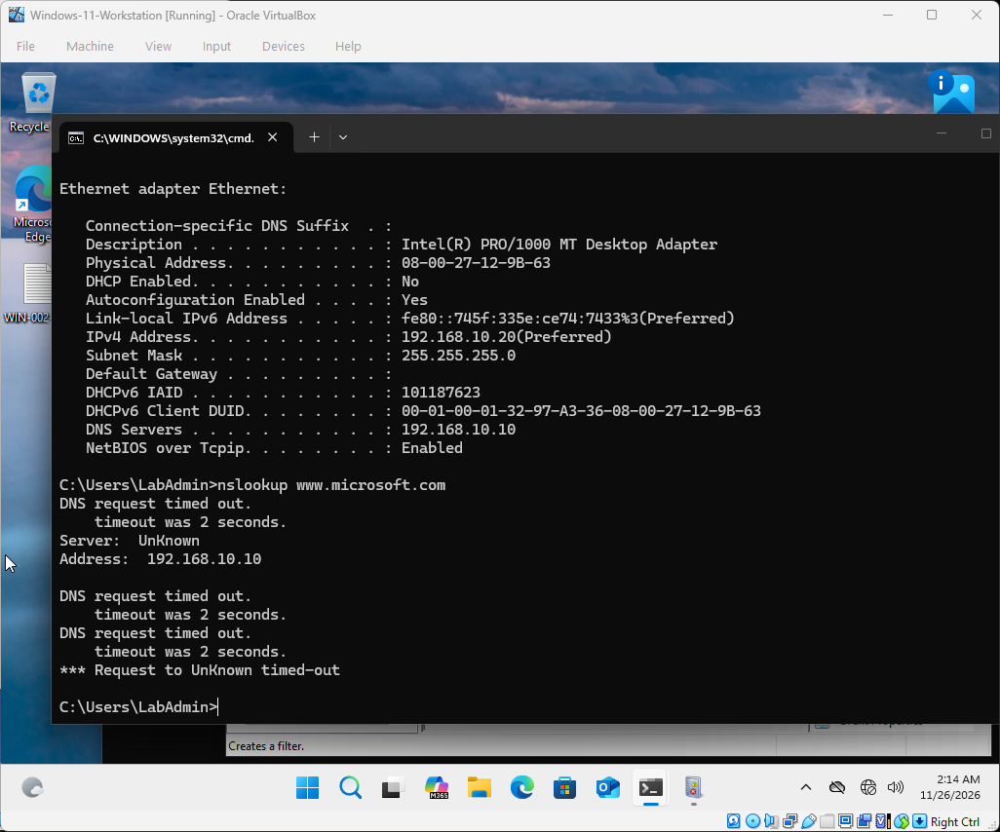

# WIN-002 — Windows Event Viewer Investigation

## Lab Overview

**Ticket:** WIN-002  
**Environment:** Windows 11 Pro / VirtualBox  
**Workstation:** MUSTAFA-PC01  
**Domain:** mustafalab.local  
**Tools:** Windows Event Viewer, Command Prompt  
**Status:** Investigated — Resolution Pending

## Issue

During a Windows Event Viewer troubleshooting exercise, an application log error was identified indicating that Windows license activation had failed.

## Objective

Investigate the Windows activation error, identify relevant event details, examine network and DNS configuration, and determine the likely cause.

## Troubleshooting Steps

1. Opened Event Viewer using `eventvwr.msc`.
2. Navigated to `Windows Logs → Application`.
3. Located a Security-SPP error.
4. Reviewed the event properties.
5. Identified the following:
   - Event ID: 8198
   - Source: Security-SPP
   - Error Code: `0x80072EE7`
   - Description: Windows license activation failed.
6. Opened Command Prompt.
7. Executed `ipconfig /all` to inspect the workstation's network configuration.
8. Confirmed the workstation IP address was `192.168.10.20`.
9. Confirmed the DNS server was `192.168.10.10`.
10. Executed `nslookup www.microsoft.com`.
11. Observed repeated DNS request timeouts.
12. Reviewed the VirtualBox internal network configuration.

## Commands Used

```cmd
ipconfig /all
```

```cmd
nslookup www.microsoft.com
```

## Findings

- The Windows workstation was configured with a static IPv4 address.
- The workstation used the Active Directory domain controller as its DNS server.
- The workstation operated on an isolated VirtualBox internal network.
- DNS queries for external Microsoft domains timed out.
- Windows Event Viewer recorded a license activation failure.

## Root Cause Analysis

The likely cause was the absence of external network connectivity in the isolated VirtualBox environment.

Because the workstation could not resolve external Microsoft domains, it likely could not contact Microsoft's activation services.

**Note:** The exact activation failure cause was not conclusively verified.

## Resolution Status

**Investigated — Resolution Pending**

The issue was documented without modifying the existing isolated lab network.

Restoring appropriate external connectivity and confirming valid Windows activation eligibility would be necessary before retesting activation.

## Skills Demonstrated

- Windows Event Viewer troubleshooting
- Windows application log investigation
- Event ID analysis
- DNS troubleshooting
- TCP/IP configuration review
- Network connectivity diagnostics
- Root cause analysis
- Technical documentation

## Screenshot Evidence

### 1. Event Viewer — Activation Error


### 2. Network Configuration and DNS Diagnostics


