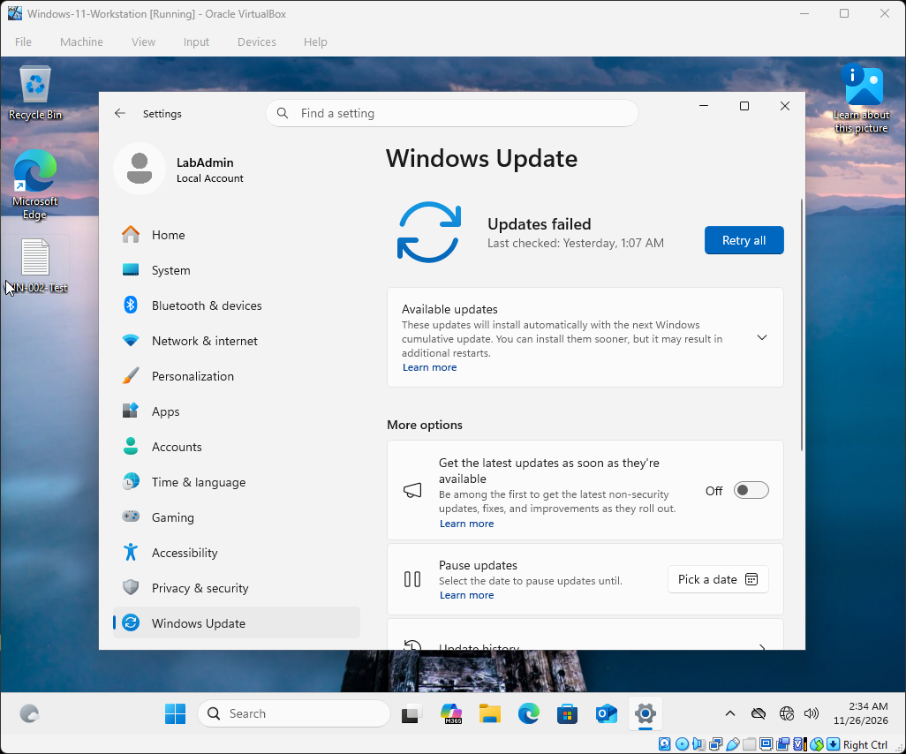
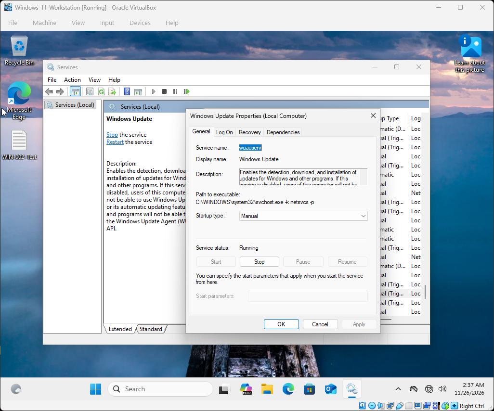
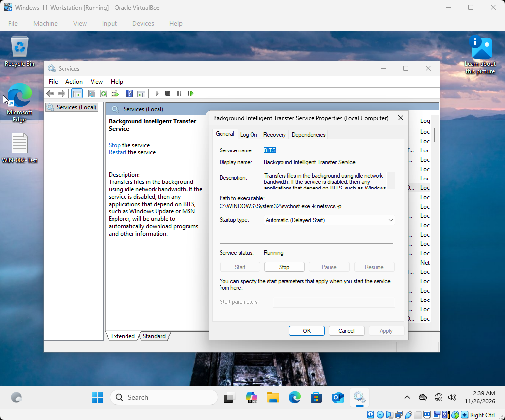
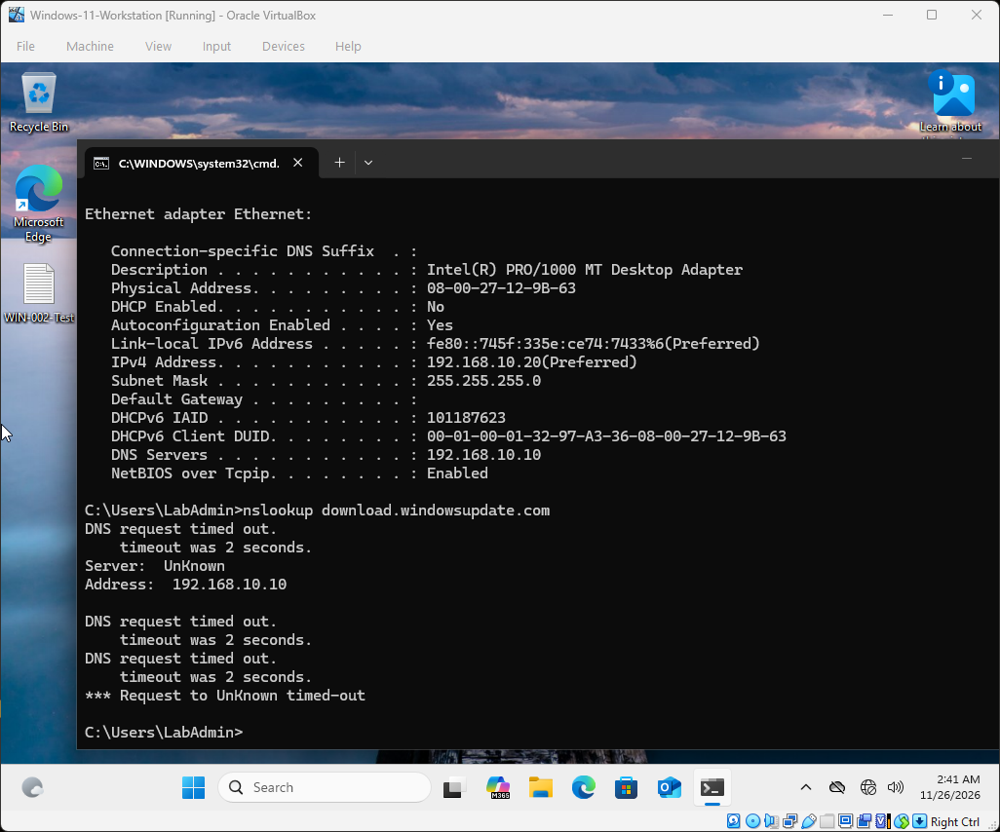
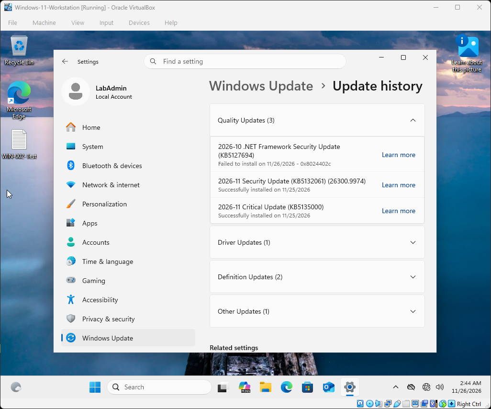

# WIN-003 — Windows Update Troubleshooting

## Lab Overview

**Ticket:** WIN-003  
**Environment:** Windows 11 Pro / Oracle VirtualBox  
**Workstation:** MUSTAFA-PC01  
**Domain:** mustafalab.local  
**Status:** Investigated — Resolution Pending

## Issue

A simulated employee reported that their Windows 11 workstation was unable to install Windows updates.

Windows Update displayed an "Updates failed" message.

## Objective

Investigate Windows Update failures by reviewing update history, checking Windows services, and performing network diagnostics.

## Troubleshooting Steps

1. Opened Windows Update and confirmed the update failure.
2. Opened Windows Services using `services.msc`.
3. Verified the Windows Update service (`wuauserv`) was running.
4. Verified Background Intelligent Transfer Service (`BITS`) was running.
5. Opened Command Prompt and executed `ipconfig /all`.
6. Confirmed the workstation's IPv4 address was `192.168.10.20`.
7. Confirmed the DNS server was `192.168.10.10`.
8. Identified that no default gateway was configured.
9. Executed `nslookup download.windowsupdate.com`.
10. Observed repeated DNS request timeouts.
11. Reviewed Windows Update history.
12. Identified a failed .NET Framework security update.

## Failed Update Details

**Update:** 2026-10 .NET Framework Security Update  
**KB Number:** KB5127694  
**Error Code:** `0x8024402C`

Other security and critical updates were successfully installed previously.

## Root Cause Analysis

The likely cause is the workstation's isolated VirtualBox network configuration, which prevents reliable communication with external Windows Update servers.

The failed DNS lookup and missing default gateway support this diagnosis.

## Resolution Status

**Investigated — Resolution Pending**

The existing isolated network configuration was preserved to maintain the Active Directory home lab.

No remediation was performed.

## Skills Demonstrated

- Windows Update troubleshooting
- Windows Services administration
- BITS service investigation
- Windows Update error-code analysis
- TCP/IP networking
- DNS diagnostics
- Root cause analysis
- Technical documentation

## Screenshot Evidence

### 1. Windows Update Failure

### 2. Windows Update Service

### 3. BITS Service

### 4. Network Diagnostics

### 5. Windows Update History

